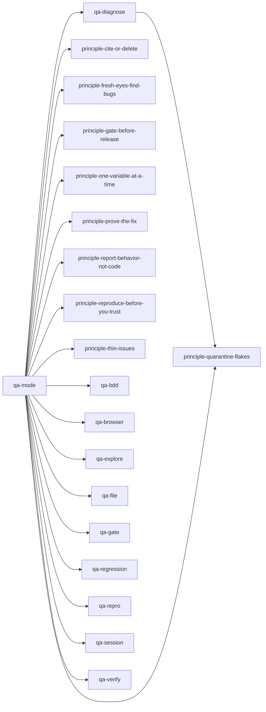

# Skill dependency graph

Generated by `scripts/skill-graph.mjs`. Do not edit by hand.

- Skills: 23
- Edges: 20
- Cycles: 0
- Dangling references: 0

## Graph

## Cycles

None.

## Dangling references

None.
